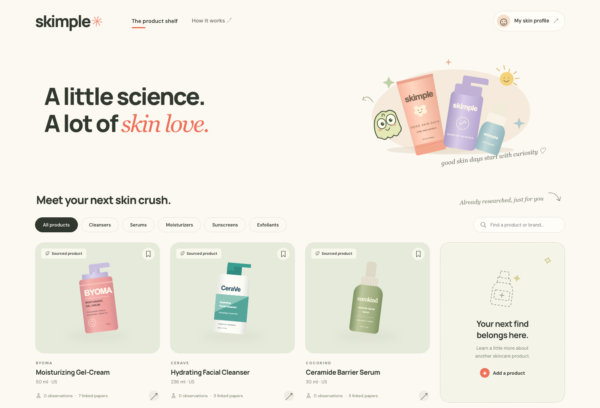
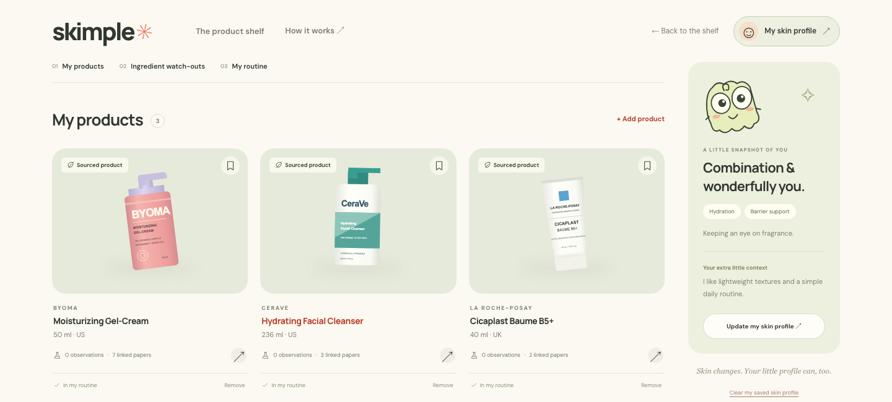

# Skimple

**A little science. A lot of skin love.**

Skimple helps you understand your skincare and keep track of what you use. Explore a product’s ingredients, read the research behind them, and bring your own skin preferences into the conversation—all in one friendly place.

## What you can do

- **Explore the shelf.** Browse researched products, filter by category, or find a brand you already know.
- **Bring your own product.** Search by name and choose a matching product, or upload a photo of the front label. Skimple looks for the ingredient list for that exact product and variant.
- **Look beyond the label.** See the full formula, ingredient findings, research sources, and available review themes. Ask questions about the product in a chat grounded in its report.
- **Make it personal.** Share how your skin feels, your goals, sensitivities, and anything else you want to add. An optional face photo can add visible observations, with your consent.
- **Build your skin space.** Keep the products you use in “My products,” bookmark products you’re curious about, and see a simple AM/PM routine and ingredient watch-outs based on your answers and shelf.

No account is needed. Your browser keeps a private visitor key so you can come back to your saved profile and products.

## A look inside

### Discover your next shelf mate

The product shelf brings products, ingredient research, and sources together. Search or filter to find a place to start.



### A little more you

Your skin space keeps your products and preferences together. This screenshot uses an example profile and three products from the researched catalog.



## Research, with the limits in view

Skimple shows where information comes from and where evidence is missing. Published ingredient lists include their source and region. Ingredient findings appear only when they are linked to reviewed claims and papers; literature awaiting scientific review is labeled separately. Product reviews appear only from approved sources and describe personal experiences, not clinical proof.

Research about an ingredient does not prove how a finished product will work for you. Skimple is an educational tool, not a diagnosis or treatment plan. Face photos do not determine your skin type or change compatibility scores.

## Your photos and data

Product photos are uploaded privately and expire after the configured retention period. Face photos are processed temporarily; only observation text, confidence, and image-quality limitations are saved with your questionnaire. New face photos are never stored in S3. If a photo is unclear or extraction fails, your previous profile stays intact and you can try again.

Your profile, reports, bookmarks, and products belong to your browser’s visitor key. Clearing browser storage loses access to them. The API provides `DELETE /v1/me/data` to remove that visitor’s data, and `DELETE /v1/me/skin-photo` to clear photo context and any older retained face media while keeping questionnaire answers.

## Run locally

You’ll need Node.js, Python 3.11 or newer, [uv](https://docs.astral.sh/uv/), Docker, a TigerData PostgreSQL database, and Gemini and Nimble API keys.

### 1. Configure the services

```sh
cp .env.example .env
```

Fill in the database, Gemini, Nimble, Redis, and S3 settings. Use the TigerData `DATABASE_URL` with the `postgresql+psycopg://` driver and `sslmode=require`; the API, worker, and migrations all use this database. There is no automatic local database fallback.

Set `ALLOWED_ORIGINS` to the address where you open the UI. The UI connects to `http://localhost:8000` by default; set `PUBLIC_API_URL` in the UI server’s environment if your API runs elsewhere.

### 2. Start Redis and media storage

```sh
docker compose up -d redis minio
```

Open the MinIO console at `http://localhost:9001`, sign in with the local credentials in `docker-compose.yml`, and create a private bucket named `skimple-media` (or the name in `S3_BUCKET`). PostgreSQL runs in TigerData; the Compose `local-postgres` profile is available for explicitly configured offline development.

### 3. Install dependencies and prepare the catalog

```sh
uv sync
npm install
uv run alembic upgrade head
PYTHONPATH=apps/api uv run python -m skimple.ops seed-products db/seeds/products.json --literature db/research/papers.json --dry-run
PYTHONPATH=apps/api uv run python -m skimple.ops seed-products db/seeds/products.json --literature db/research/papers.json
```

The seed includes ten products and nine verified PubMed records. You can run the import again without creating duplicates. See the [catalog research notes](docs/catalog-research.md) for sources and refresh instructions.

### 4. Start the app

Run each command in a separate terminal:

```sh
# API
uv run uvicorn skimple.api:app --reload --app-dir apps/api
```

```sh
# Background worker
uv run rq worker scans analyses --url redis://localhost:6379/0 --with-scheduler --worker-class rq.worker.SimpleWorker
```

```sh
# Web interface
npm run dev
```

Open **http://localhost:3000**. Keep the API and worker running to use product lookup and analysis. The shelf loads from the seeded database; if the service is unavailable, it shows a retry button instead of substituting sample products. Opening `index.html` directly redirects to the local web server. API documentation is at `http://localhost:8000/docs`.

### Optional face-photo context

Set `ENABLE_FACE_PHOTO=true` in `.env` and restart the API to enable this flow. It uses the configured Gemini key and model and does not require S3. The flag is off by default.

Choose a JPEG, PNG, WebP, or HEIC photo, at least 400 × 400 pixels and no larger than 10 MB. After consent, Skimple corrects orientation, removes metadata, and extracts visible observations. It saves the text and your current questionnaire answers together, including unsaved answers. Transient provider errors get bounded retries; closing the dialog cancels the browser request.

## Checks

```sh
uv run pytest
uv run ruff check apps/api tests
uv run ruff format --check apps/api tests
npm run build
```

For browser tests, install Chromium, start the UI on port 4173, and run the journeys in another terminal. These tests intercept API responses.

```sh
npx playwright install chromium
PORT=4173 npm run dev
# In another terminal:
npm test
```

`npm run test:face` runs just the face-photo journey. To check the backend against TigerData, run `SKIMPLE_TEST_POSTGRES=1 uv run pytest`. It creates and removes an isolated test schema; application tables are never used. `SKIMPLE_TEST_DATABASE_URL` can override the configured database for that run.

With the API and UI running against the seeded database, run `SKIMPLE_TEST_LIVE=1 npm run test:connected` for a real browser check. It creates a temporary visitor and removes that visitor’s data afterward. Use `BASE_URL` to override the default `http://localhost:3000`, and include that origin in `ALLOWED_ORIGINS`.

See the [deployment notes](docs/deployment.md) for hosting, research curation, media retention, and [database migration](docs/deployment.md#transfer-an-existing-local-database).
