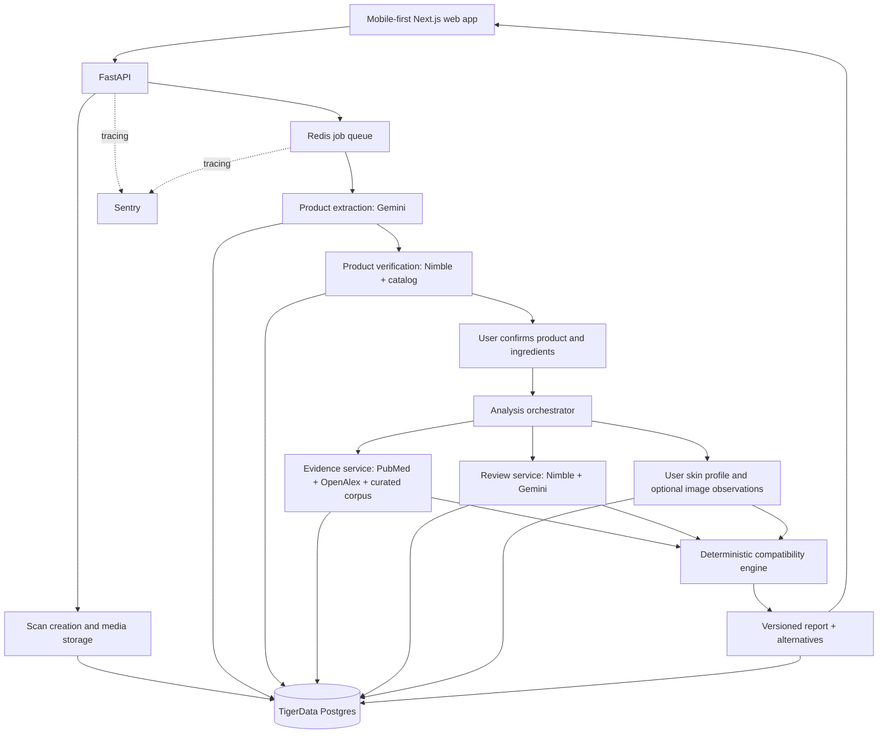

# Skincare AI — Final Implementation Plan

**Status:** Approved architecture direction  
**Version:** 1.0  
**Date:** October 11, 2026  
**Delivery target:** 8–10 weeks for a controlled MVP/beta (planning estimate; ~2–3 experienced engineers with domain review)  
**Primary database:** TigerData PostgreSQL  
**Out of scope:** Snowflake — not used in the MVP or planned architecture

---

## 1. Product overview

Build a mobile-first web application where a user:

1. Uses their device camera to capture the front and back of a skincare product.
2. Has AI identify the **brand, exact product, variant, and ingredient list**, with a chance to correct mistakes.
3. Receives an analysis of **product-specific online reviews and user sentiment**, using **Nimble** for web search and extraction wherever appropriate and permitted.
4. Receives a **scientific evidence assessment** of ingredients based on relevant skincare/dermatology research, with verifiable citations and transparent evaluation of study quality.
5. Creates a **skin profile**, primarily through a questionnaire and optionally through a face photo for limited visible-feature observations.
6. Receives an explainable **personal compatibility report**, including benefits, risks, uncertainty, and alternatives.

### Product positioning

> Scan any skincare product. Understand the science. Know whether it may suit your skin.

### Foundational principles

- **Evidence over hype:** Don't treat raw citation counts, impact factors, or popular reviews as proof of efficacy or safety.
- **Traceability:** Every scientific claim must point to the underlying paper(s); every user-review finding must point to a permitted source or aggregate with provenance.
- **Safety:** Do not claim to diagnose skin conditions or definitively identify skin type from a single photo.
- **Deterministic decisions:** LLMs extract and summarize; code validates identities, enforces rules, and calculates scoring outputs.
- **Reuse knowledge:** Research should be precomputed and cached rather than repeatedly searched for each scan.
- **One operational database:** Store all durable application data in TigerData PostgreSQL; don't introduce Snowflake.

---

## 2. Scope

### MVP (must-have)

- Browser camera and upload fallback for front/back package images.
- Gemini-powered structured extraction of product identity and full ingredient list.
- Nimble-assisted manufacturer/product verification; user correction and confirmation UI.
- INCI normalization, synonyms, ingredient deduplication, and formula version awareness.
- PubMed and OpenAlex research indexing for a curated starter set of skincare ingredients.
- Study-screening, evidence extraction, and outcome-specific evidence confidence.
- Nimble product-review discovery; source-aware, aspect-based sentiment summaries.
- Skin questionnaire covering oiliness/dryness tendencies, sensitivities, routine and goals.
- Personalized report with evidence citations, uncertainty, and recommended alternatives.
- TigerData storage, background task processing, and Sentry tracing/observability.
- Security, deletion and consent flows, and evaluation suites.

### Experimental MVP feature

- Optional face photo to identify **visible observations only** (such as apparent shine, flaking, or redness) with confidence limitations. **Never** use a photo alone to diagnose conditions or determine true skin physiology.

### Post-MVP (not release blockers)

- Longitudinal skin tracking, routine interaction checks, consented feedback-driven personalization, broader global product coverage, multilingual packaging, and richer image-based analysis following validation.

### Explicit exclusions

- Snowflake; a second analytics warehouse is unnecessary for MVP.
- General-purpose autonomous research agents without bounded source/tool policies.
- Definitive clinical claims, diagnoses, or personalized treatment prescriptions.
- Unlimited crawling or unlicensed storage of third-party review text.

---

## 3. Final technology stack

| Layer | Technology | Responsibility |
| --- | --- | --- |
| Frontend | Next.js, React, TypeScript, Tailwind CSS | Camera workflow, skin profile, status, reports |
| Backend | Python, FastAPI, Pydantic | HTTP APIs, orchestration, data validation, scoring |
| Multimodal and language AI | Google Gemini | Product/ingredient extraction, study information extraction, review synthesis, bounded explanations |
| Web discovery/extraction | **Nimble** | Product identity verification, manufacturer listings, review discovery and accessible page extraction |
| Research discovery and metadata | PubMed E-utilities, OpenAlex | Biomedical literature, DOI/PMID data, normalized citation influence |
| Primary database | **TigerData PostgreSQL** | Users, products, formulations, ingredients, scientific corpus, reviews, reports, job state |
| Search | PostgreSQL full-text/hybrid search + TigerData-supported pgvector/pgvectorscale/pg_textsearch where available | Claim-specific research retrieval, ingredient/entity matching |
| Background jobs | Redis + Python worker(s) | Async ingest, analysis, retries, refresh and scheduled jobs |
| Media | Private S3-compatible object storage | Short-lived product photos and consent-controlled face media |
| AI and app observability | **Sentry** | Distributed traces, Gemini/tool spans, exceptions, latency, usage/cost metadata |
| Hosting | Vercel (frontend) + Python container service (API/workers) | Production deployment |
| Authentication | Managed OIDC provider | Account login/session management |

**Model policy:** Pin a supported Gemini model ID through configuration. Evaluate its multimodal accuracy, structured-output reliability, latency, and cost before production. Keep model IDs and prompts versioned; avoid building on undocumented or unconfirmed versions.

**Nimble policy:** Use the current supported Nimble Search/Extract endpoints for general web data. Use PubMed/OpenAlex directly for authoritative literature/metadata. Respect source access terms and verify API availability, quotas, and content-use rights before rollout.

---

## 4. System architecture



### Runtime boundaries

- **Synchronous:** create scan, fetch scan status, submit corrections, fetch saved report.
- **Asynchronous:** OCR/model extraction, live product verification, scientific updates, review retrieval, report generation.
- **Parallel where safe:** Research evidence retrieval and review sentiment analysis, after product identity and formula confirmation.
- **No Snowflake replication:** TigerData is the system of record for operational and analytical MVP needs.

### Example job states

`CREATED → EXTRACTING → IDENTIFYING → NEEDS_CONFIRMATION → RESEARCHING → REVIEW_ANALYSIS → SCORING → COMPLETED`

Failure/exception states: `PARTIAL`, `FAILED`, `CANCELLED`, `EXPIRED`.

Use stable job IDs and idempotency keys. Resume retryable stages without duplicating records or charging for repeated completed steps.

---

## 5. Module A — Camera capture, product identity and INCI extraction

### User flow

1. Request camera permission only after the user starts scanning (`getUserMedia`); allow ordinary file upload if denied.
2. Capture front and back, offer retakes and zoom guidance. Check focus/legibility when possible.
3. Upload images via signed URLs or a tightly controlled backend endpoint to private object storage.
4. Gemini extracts structured fields: `brand`, `product_name`, `variant`, `size`, `barcode_if_visible`, `raw_ingredient_text`, `ingredients_in_order`, `language`, and per-field uncertainty.
5. Query TigerData for exact/near matches. On an uncertain match, use Nimble to retrieve official manufacturer pages and matching listings.
6. Compare formula text with packaging; **physical packaging normally takes precedence for that scanned unit**. Flag contradictory/partial sources, differing markets, or possible reformulations.
7. User confirms or edits the identity and ingredients before personalized analysis proceeds.
8. Canonicalize ingredients to INCI names and synonyms; preserve the exact scanned string, order, provenance, and formula hash.

### Important edge cases

- Glare and curved bottles; tiny ingredient text; multilingual labels; truncated images.
- Two products with the same name but different sizes/variants/markets.
- Reformulated products that share a product URL/UPC.
- Ingredient synonyms and trade names; punctuation and OCR mistakes.
- Unlisted exact ingredient concentrations. Do not infer concentration solely from order.

### Acceptance goals (initial targets for a representative benchmark)

- ≥90% exact brand/product/variant match accuracy when enough label information is visible.
- ≥95% ingredient-token accuracy on legible labels, with a separate strict exact-list accuracy metric.
- Uncertain or incomplete ingredient extraction is always disclosed and correctable.
- No product analysis runs against an unconfirmed or wrongly matched formulation.

These are launch targets, not established model performance claims; refine after measuring the baseline.

---

## 6. Module B — Scientific evidence engine

### Data acquisition

- Maintain a curated set of initial common skincare ingredients and their synonyms.
- Search **PubMed** for skin/dermatology-relevant studies with ingredient-specific terms and outcome filters.
- Resolve citations/identifiers and metadata with **OpenAlex** (DOI, year, publication type, citation counts, normalized citation influence, journal).
- Use lawful full text (e.g. open access) when available; otherwise analyze abstracts conservatively and note the limitation.
- Track source metadata, retrieval timestamps, updated/corrected records, and retraction status where discoverable.

### Inclusion/exclusion logic

For each proposed ingredient-outcome link, screen for:

- **Topical human skin relevance** (stronger directness than oral, animal, or in-vitro studies).
- Correct ingredient/chemical entity and relevant concentration, vehicle, application duration.
- Study type (systematic review, randomized trial, nonrandomized trial, observational, mechanistic).
- Relevant endpoints (hydration, transepidermal water loss, acne-related outcomes, hyperpigmentation, irritation, etc.).
- Methods and bias concerns, study limitations, conflicts, retractions, and contradictory results.

### Study extraction using Gemini

Output structured data only, with evidence snippets or traceable locations where licensing permits:

```json
{
  "paper_id": "paper_123",
  "ingredient_id": "inci_456",
  "outcome": "skin_barrier_support",
  "population": "adults with ...",
  "route": "topical",
  "concentration": "as reported or unknown",
  "design": "randomized_controlled_trial",
  "sample_size": null,
  "effect_direction": "positive|negative|mixed|none|uncertain",
  "limitations": [],
  "extractor_model_version": "configured-gemini-model-id"
}
```

Fail closed for missing or unverifiable identifiers; never fabricate a DOI, paper, sample size, or effect.

### Evidence scoring — two different concepts

**A. Study-quality/relevance rubric (proposed starting weights, to validate with expert review)**

| Dimension | Proposed weight |
| --- | ---: |
| Study design and evidence hierarchy | 35% |
| Direct topical/skincare relevance | 25% |
| Methodological rigor and bias | 20% |
| Field-/age-normalized citation influence | 15% |
| Journal-level standing | 5% |

Journal impact factor and citation counts are **secondary contextual signals**, not measures of truth. High-impact negative or contradictory studies must strengthen evidence of concern, not boost an ingredient's favorability.

**B. Claim-level evidence confidence**

Aggregate consistent, directly applicable findings for the **specific outcome, route, population and concentration**, accounting for contradictory studies and missing information. Classify as `strong`, `moderate`, `limited`, `conflicting`, or `insufficient`. Keep this independent from whether the observed outcome is beneficial, harmful, or neutral.

### Persistence and caching

- Papers keyed by DOI/PMID/OpenAlex ID where possible.
- Studies linked to ingredients and **specific claims**, not just generic ingredient records.
- Upsert metadata rather than duplicate papers across scans.
- Version claim synthesis and support a manual scientific review/override workflow.
- Refresh metadata and research in scheduled jobs, not on each product scan.

---

## 7. Module C — Product reviews and sentiment using Nimble

### Retrieval

Generate bounded, specific searches from the exact product identity, e.g.:

- `"<brand> <product> <variant>" review`
- `"<brand> <product> <variant>" reddit`
- `"<brand> <product> <variant>" irritation breakout`
- `"<brand> <product> <variant>" oily skin dry skin`

Use Nimble Search for discovery and permitted extraction endpoints/templates for source content. Favor manufacturer and reputable retailer identity confirmation, but distinguish promotional product claims from genuine consumer experiences.

### Processing

1. Normalize source records: URL, publication/review date, product variant, retrieved timestamp, author ID if permitted, review context.
2. Deduplicate syndicated reviews, reposts and fragments.
3. Use Gemini to classify **aspect-based sentiment** rather than only positive/negative overall polarity.
4. Extract explicitly mentioned experiences such as hydration, pilling, stickiness, acne breakouts, irritation, fragrance and sensitivity.
5. Capture *self-reported* skin type only when the review says it; never invent it.
6. Aggregate with denominator/sample count and source mix; show uncertainty for sparse or skewed samples.
7. Store content only as allowed by licensing/source policies. Use a source-permissions registry and avoid exposing copyrighted full reviews.

### Outputs

- Sentiment distribution by aspect.
- Count of unique/classifiable observations and source diversity.
- Recurring positive/negative themes and variant matching confidence.
- Relevant subset of reviews from self-described similar-skin users, where sample size permits.
- Links/provenance and last refresh time.

**Important:** Reviews are observational anecdotes, not clinical evidence or verified causation.

---

## 8. Module D — Skin profile and optional facial image observations

### Questionnaire (MVP baseline)

Gather the user's:

- Skin feel after cleansing and oiliness during the day.
- Typical areas of dryness/oiliness, product sensitivity and known ingredient reactions.
- Primary goals (hydration, blemish management, dullness, uneven tone, etc.).
- Relevant routine products and usage frequency when available.
- Optional known allergies or professional advice; use this only for conservative screening, not for diagnosing.

Derive a questionnaire-backed skin profile with confidence indicators rather than asserting ground truth.

### Optional image feature (experimental)

- User explicitly opts in and captures one or more photos with image quality checks.
- Gemini identifies limited **visible attributes** (e.g. apparent shine, flaking, redness, blemishes) with uncertainty.
- Never diagnose eczema, rosacea, acne severity, malignancy or other medical conditions from a photo.
- Never assume actual sebum production or skin hydration from a single image.
- Test across lighting, camera types, and diverse skin tones before release.
- Default to short-lived media; consent is required for any longer retention or learning use.

If images are unavailable or assessment confidence is low, continue with questionnaire-based recommendations.

---

## 9. Module E — Deterministic personalized compatibility engine

### Inputs

- Confirmed **formulation**, not just product marketing name.
- Ingredient/claim evidence with route, concentration, vehicle and applicability caveats.
- Questionnaire profile and optional limited image observations.
- Product-specific review signals with sample sizes.
- Known sensitivities and user goals.

### Recommended scoring design

Avoid one opaque "safety score." Expose:

1. **Benefit fit** — extent to which supported ingredient/formulation properties match user goals.
2. **Irritation/compatibility concerns** — context-aware warnings, especially for known allergies and reported sensitivity.
3. **Evidence confidence** — strength and directness of support; penalize unknown concentration and formula information.
4. **Review signal** — separate, clearly labeled experiential information.

Use deterministic policy gates for allergies, red flags, and low-evidence situations. A generic score **never overrides** a warning. If information is insufficient, state `uncertain` rather than declaring the product safe or unsafe.

### Alternatives

- Compare within the same **product purpose/category**, budget and any stated restrictions.
- Filter out known concern ingredients where relevant, based on user-specified reactions.
- Rank candidates using compatible formulation signals and evidence confidence.
- Reuse the same scanning/evidence pipeline for alternative products to avoid one-sided comparisons.
- Explain *why* each alternative might be preferable and what evidence remains unknown.

### Example response contract (illustrative, not an actual recommendation)

```json
{
  "report_id": "rpt_123",
  "formulation_id": "formula_456",
  "compatibility": {
    "classification": "possibly_suitable",
    "benefit_fit_score": 78,
    "irritation_concern": "uncertain",
    "confidence": "moderate",
    "limitations": ["Active ingredient concentrations are not disclosed"]
  },
  "ingredient_findings": [
    {
      "ingredient": "Niacinamide",
      "outcome": "skin_barrier_support",
      "effect": "potential_benefit",
      "evidence_confidence": "moderate",
      "claim_id": "claim_789",
      "paper_ids": ["paper_001"]
    }
  ],
  "product_review_summary_id": "review_summary_123",
  "alternatives": [],
  "analysis_version": "v1"
}
```

---

## 10. TigerData PostgreSQL — data model

Use one managed TigerData PostgreSQL instance as the MVP system of record. Separate schemas or logical namespaces can organize domains without adding new databases.

| Entity/table | Key fields and notes |
| --- | --- |
| `users` | User ID, auth-provider ID, preferences, timestamps |
| `consents` | User ID, scope, version, timestamp, revocation |
| `skin_profiles` | Questionnaire JSONB, derived attributes, confidence, version |
| `skin_photo_assessments` | Temporary media ref, allowed observations, consent, expiry |
| `brands` | Canonical brand, official domain, aliases |
| `products` | Brand ID, name, category, product identifiers |
| `product_formulations` | Product ID, region, variant, normalized ingredient hash, version, source |
| `ingredients` | Canonical INCI name, synonyms, functions |
| `formulation_ingredients` | Formulation ID, ingredient ID, position, disclosed concentration, raw OCR span |
| `product_scans` | User, image refs, extraction data, confirmation state, formulation ID |
| `papers` | DOI, PMID, OpenAlex ID, title, year, journal, citation metadata |
| `study_findings` | Paper, ingredient, outcome, design, population, effect, limitations |
| `ingredient_claims` | Ingredient, specific skincare outcome, synthesis and confidence, version |
| `claim_papers` | Many-to-many support/contradiction relation, relevance scores |
| `review_sources` | Website/source permissions, URLs, refresh policy |
| `review_observations` | Source, formulation/product match, aspect, sentiment, provenance |
| `product_sentiment` | Aspect aggregates, sample sizes, methodology, refresh time |
| `analysis_runs` | Scan/profile/formulation references, status, stage times, Sentry trace ID |
| `reports` | User, run ID, scoring output, explanation, evidence snapshot/version |
| `report_evidence` | Report claims to papers and allowed web sources |
| `recommendation_feedback` | Optional experience feedback, consent, timestamp |
| `job_runs` | Job kind, idempotency key, attempts, errors, next retry |

### Database rules

- Enforce foreign keys and unique indexes on stable IDs and formulation hashes.
- Index canonical product names, identifiers, ingredient synonyms, publication IDs and status fields.
- Enable extensions/features available on the selected TigerData deployment (vector/keyword search as supported).
- Use JSONB for flexible model extraction artifacts **without** replacing normalized identity tables.
- Version prompts, scoring rules, retrieval dates and model IDs for reproducible reports.
- Partition or use TimescaleDB hypertables for large time-oriented telemetry/event collections *only if scale warrants it*.
- Apply tenant/user authorization at the API layer and database policies where practical.
- Set lifecycle policies for temporary images and review data; implement user deletion/erasure workflows.

---

## 11. API specification (v1)

| Method | Route | Behavior |
| --- | --- | --- |
| `POST` | `/v1/scans` | Create scan and register front/back images |
| `GET` | `/v1/scans/{scan_id}` | Get extraction status and candidate identity |
| `POST` | `/v1/scans/{scan_id}/confirm` | Confirm/correct product identity and ingredient list |
| `PUT` | `/v1/me/skin-profile` | Save questionnaire/profile information |
| `POST` | `/v1/me/skin-photo` | Consent-controlled optional image observation request |
| `DELETE` | `/v1/me/skin-photo` | Delete retained optional facial media/assessment where applicable |
| `POST` | `/v1/analyses` | Start an idempotent personalized analysis |
| `GET` | `/v1/analyses/{analysis_id}` | Poll analysis progress and recoverable errors |
| `GET` | `/v1/reports/{report_id}` | Read completed, versioned report |
| `GET` | `/v1/reports/{report_id}/alternatives` | Retrieve ranked alternatives |
| `POST` | `/v1/reports/{report_id}/feedback` | Submit optional feedback |
| `DELETE` | `/v1/me/data` | Initiate authenticated data-deletion workflow |

### API conventions

- Pydantic request/response schemas and explicit schema versioning.
- Auth required for private profile/reports; ownership checks on every ID-based lookup.
- Upload limits, MIME/file-content validation, rate limits, signed URLs and expiration.
- Idempotency keys on scan/analysis creation and worker mutations.
- Consistent HTTP error codes and retriable/nonretriable job failure reasons.
- Polling for MVP; optional SSE/websocket progress after initial release.

---

## 12. Observability with Sentry

Initialize Sentry in the Next.js app, FastAPI app and background workers. Instrument Google GenAI calls using supported integrations/manual spans as appropriate for the SDK versions selected.

### Root trace example

```text
scan.analyze
  gemini.extract_product
  postgres.match_formulation
  nimble.search_product
  nimble.extract_product_page
  user.confirm_formulation
  research.lookup_claims
  nimble.search_reviews
  gemini.classify_review_aspects
  scoring.compute_compatibility
  report.persist
```

### Capture per run

- Request/scan/analysis IDs and a privacy-safe correlation identifier.
- Span latency, status, retry counts, error categories and cache hit/miss.
- Gemini model ID, token usage (if available), prompt version, output-schema validation results and estimated cost.
- Nimble request count, provider latency/status and rate limiting.
- PubMed/OpenAlex responses, source counts and bibliographic-resolution failures.
- Report generation time, extraction correction rate and citation-validation failures.

### Privacy configuration

- Disable or sanitize raw prompt/output capture where user photos, self-reported health information, or other sensitive data could be included.
- Never attach unredacted face photos or confidential profile data to monitoring events.
- Use sampling, retention limits and access controls.
- Explicitly test error paths for accidental sensitive-data leakage.

### Initial alerts

- Product extraction/model schema failures.
- Nimble/API failures or unusually high retry rates.
- Unverifiable citations in reports.
- Analysis time-to-completion regressions.
- Token/tool cost anomalies per successful scan.

---

## 13. Security, privacy and product safety

- Display clear educational-not-medical-diagnosis positioning; provide appropriate referral guidance for concerning symptoms.
- Do not promise a product is universally "safe" for any skin type.
- Obtain specific consent for face-photo use; separate consent for optional retention, research, or personalization feedback.
- Encrypt data in transit and at rest; restrict object storage and signed URL lifetime.
- Build a deletion mechanism for images, user profiles, and related report records consistent with retention obligations.
- Do not allow web pages or reviews to inject tool instructions; treat all retrieved text as untrusted evidence.
- Validate scientific claims against source IDs and deterministic citation checks before publishing.
- Observe rate limits, robots/terms, copyright, and commercial reuse permissions for third-party web content.
- Apply safeguards against cross-user data access and insecure file uploads.
- Have a dermatologist/cosmetic scientist review representative recommendation outputs and high-risk rules before public launch.

---

## 14. Evaluation and QA

Build version-controlled golden test sets **before** optimizing prompts.

| Evaluation suite | Test coverage | Key metric |
| --- | --- | --- |
| Product identification | Similar labels, different variants, reformulations, regional packaging | Exact brand/product/variant match |
| Ingredient extraction | Tiny type, glare, curved packages, multilingual packaging | Token accuracy, exact-list accuracy, correction rate |
| Research screening | Topical vs oral vs animal studies, ambiguous synonyms, retractions | Inclusion precision/recall |
| Paper extraction | Effect direction, design, controls, concentration, populations | Field-level correctness vs expert labels |
| Evidence synthesis | Contradictory studies and unknown concentration | Citation support rate and adjudicator agreement |
| Reviews | Wrong products, duplicates, promotional content, mixed sentiment | Match precision, deduplication, aspect accuracy |
| Compatibility | Reported allergies, multiple actives, incomplete profiles | Rule accuracy, uncertainty calibration, harmful overclaim rate |
| Face-photo pilot | Different skin tones, lighting and devices | Validation quality and performance disparities |
| Operations | Retries, failover, high concurrency, provider outages | Completion rate, latency, idempotency |

### Quality gates

- No fabricated DOI/PMID/study or product-review citation in an accepted report.
- No definitive diagnosis or unsupported ingredient safety claims.
- Every user-visible scientific finding maps to a versioned evidence record.
- Provider failures degrade gracefully: cached result, partial report with explicit limitations, or actionable retry.
- Changes to Gemini prompts/models, ranking rules, and retrieval behavior trigger automated regression evaluation.

---

## 15. Work plan and milestones

**Timeline assumption:** 8–10 weeks with 2–3 engineers working in parallel, plus scientific/clinical advisory review. Actual duration depends on product diversity, source licensing and evaluation outcomes.

### Week 1 — Project foundation

- [ ] Initialize TypeScript/Next.js + Python/FastAPI monorepo, formatting, tests and CI.
- [ ] Set up TigerData PostgreSQL, migrations and initial indexes.
- [ ] Configure private media storage, OIDC auth, Redis/worker deployment and secrets.
- [ ] Configure Sentry traces, redaction, app error capture and tool-span conventions.
- [ ] Implement scan lifecycle and typed API contracts.

**Exit:** Deployed development environment with traceable, authenticated scan creation and reliable database migrations.

### Weeks 2–3 — Camera and product extraction

- [ ] Responsive scanner UI and image upload/retake flows.
- [ ] Gemini structured extraction with validation and model/version logging.
- [ ] Catalog matching and Nimble manufacturer/product verification.
- [ ] Ingredient canonicalization and confirmation/edit screen.
- [ ] Build packaging golden set and extraction evaluation runner.

**Exit:** A real product can be scanned, correctly identified or corrected, and its confirmed formula saved to TigerData.

### Weeks 3–5 — Scientific evidence layer

- [ ] Curated ingredient ontology and outcome taxonomy.
- [ ] PubMed ingestion + OpenAlex identifier/metric enrichment.
- [ ] Study screening, Gemini structured extraction and audit trail.
- [ ] Claim-level relevance and methodological scoring; citation validation.
- [ ] Ingredient evidence cache and refresh jobs.
- [ ] Scientific domain review of initial claim summaries.

**Exit:** Evidence-backed ingredient claims are queryable, cited and reproducible.

### Weeks 4–6 — Nimble reviews and sentiment

- [ ] Live product-specific Nimble search/extract integration with rate controls.
- [ ] Source permissions and product-variant verification.
- [ ] Deduplication, aspect-based Gemini sentiment classification.
- [ ] Review aggregation, source counts, confidence and refresh TTLs.
- [ ] Review regression test suite.

**Exit:** A confirmed product receives a source-aware sentiment summary with no invented review experiences.

### Weeks 6–7 — Personalization and report UI

- [ ] Skin questionnaire and conservative profile inference.
- [ ] Deterministic policy checks and explainable compatibility scoring.
- [ ] Report composer, uncertainty labels and paper references.
- [ ] Same-category, evidence-aware alternatives.
- [ ] Export/share-friendly report page (without exposing private user data).

**Exit:** A complete scan-to-report experience works without facial photography.

### Weeks 7–8 — Optional facial-image pilot

- [ ] Explicit consent screen and ephemeral image lifecycle.
- [ ] Gemini visible-feature observations, confidence and no-diagnosis guardrails.
- [ ] Lighting/device/skin-tone evaluation and opt-out path.
- [ ] Uncertain-image fallback to questionnaire.

**Exit:** Image feature is enabled only if representative evaluation supports it; otherwise keep behind a feature flag.

### Weeks 9–10 — Quality, security and controlled beta

- [ ] Evaluate all golden datasets and fix significant regressions.
- [ ] Scientific/cosmetic expert review of representative reports and red flags.
- [ ] Check third-party data rights, disclosures, privacy and deletion controls.
- [ ] Load test provider quotas and concurrent analyses; tune caches and retries.
- [ ] Monitor Sentry for failure rates, latency and per-report cost.
- [ ] Release to limited beta and collect opt-in product feedback.

**Exit:** Stable, defensible beta with measured accuracy, limitations and operating costs.

---

## 16. MVP success metrics

Track these from day one (targets are planning hypotheses, not guaranteed results):

### Accuracy and trust

- Exact product identity accuracy on benchmark images.
- Ingredient extraction precision/recall and user correction frequency.
- Percentage of scientific claims with verified sources (target: **100%**).
- Paper-level extraction agreement with human annotations.
- Frequency of unsupported or overly confident compatibility claims (target: **zero critical violations**).

### Product experience

- Scan completion and image-recapture rate.
- Time from upload to a useful identified product; time to completed report.
- Percentage of users correcting ingredients/product identity.
- Report usefulness feedback and alternative recommendation engagement.

### Reliability and unit economics

- Percentage of analysis runs completed without user retry.
- Cost per completed **cold** report versus **warm cached** report.
- Gemini token cost, Nimble query/extraction cost, and worker infrastructure cost.
- Cache reuse on ingredient research, product metadata and review summaries.
- Sentry error rate, provider rate limiting, p50/p95 latency and queue wait.

---

## 17. Cost and scalability guidelines

**Avoid hard-coded per-report price promises** until actual usage is benchmarked against current Gemini/Nimble pricing, source-access rights and cache hit rates.

1. Precompute ingredient evidence for the curated catalog. Refresh on a schedule.
2. Store product identity and formulation hashes; don't run live web discovery for known, validated products unless data is stale.
3. Cache review summaries by exact product/formulation identity with source-aware expiration.
4. Use concise Gemini structured outputs and a bounded number of generation/retry calls.
5. Parallelize independent retrieval while respecting provider quotas.
6. Add request-budget guards and graceful partial reports when sources are unavailable.
7. Track cost separately for cold scans, returning users, experimental face analysis and scientific ingestion.
8. Scale workers independently of API traffic. Optimize TigerData indexes before considering other databases.

**No Snowflake:** TigerData provides sufficient relational storage, retrieval and initial analytics; evaluate advanced analytics needs only after product usage warrants them.

---

## 18. Project structure (proposed)

```text
skincare-ai/
  apps/
    web/                     # Next.js UI, camera, profile, report
    api/                     # FastAPI routes, auth, orchestration
    worker/                  # Background jobs, retries, refresh jobs
  packages/
    contracts/               # Shared API schema/OpenAPI-generated types
  services/
    product_extraction/      # Gemini vision, OCR checks, INCI normalization
    product_search/          # Nimble identity verification
    evidence/                # PubMed, OpenAlex, scoring, retrieval
    reviews/                 # Nimble review pipeline, sentiment
    skin_profile/            # Questionnaire + optional photo observations
    compatibility/           # Deterministic rules, scores, alternatives
    reporting/               # Report assembly, provenance
  db/
    migrations/
    seeds/
  evals/
    datasets/
    extraction/
    evidence/
    reviews/
    compatibility/
  infra/
  docs/
```

Prefer a simple deployable backend and worker setup over distributed microservices. Separate packages/modules by responsibility so services can be extracted later if required.

---

## 19. First sprint — executable task list

- [ ] Create the monorepo, lockfiles, formatting/linting, tests and CI workflows.
- [ ] Provision TigerData PostgreSQL and create migrations for `brands`, `products`, `product_formulations`, `ingredients`, `formulation_ingredients`, `product_scans`, `analysis_runs`.
- [ ] Implement OIDC authentication and user ownership checks.
- [ ] Set up private media upload with signed URLs and expiry/deletion.
- [ ] Implement `POST /v1/scans` and `GET /v1/scans/{scan_id}`.
- [ ] Implement front/back camera capture and upload fallback in Next.js.
- [ ] Integrate Gemini via a pinned, supported model with Pydantic structured extraction.
- [ ] Integrate Nimble for official manufacturer/product identity lookup.
- [ ] Build ingredient confirmation/correction UI; save canonical formula and source text.
- [ ] Add Sentry spans for scan creation, Gemini extraction, Nimble lookup and persistence, with PII-safe defaults.
- [ ] Create initial real-world packaging golden dataset and extraction benchmark.

### Sprint 1 definition of done

A user opens the web app on a phone, captures the front/back of a real product, verifies the AI-extracted identity and ingredient list, corrects any errors, and sees the confirmed result persisted in TigerData. Sentry traces the end-to-end operation, and an automated benchmark detects extraction regressions.

---

## 20. Core architectural decisions

| Decision | Final choice | Rationale |
| --- | --- | --- |
| Primary datastore | **TigerData PostgreSQL** | Single durable home for relational data, evidence and search |
| Snowflake | **Not used** | No clear MVP need; avoids duplicate storage and synchronization |
| General web retrieval | **Nimble-first** | One provider for search and accessible page extraction |
| Scholarly retrieval | **PubMed + OpenAlex** | Specialized bibliographic and scientific metadata |
| AI model | **Google Gemini** | Vision and bounded text/structured-output tasks |
| Observability | **Sentry** | Traces across frontend, backend, model and tools |
| Scoring | **Deterministic code + auditable evidence** | Improves reproducibility and reduces hallucination risk |
| Face analysis | **Optional, limited, evaluated** | A photo is not a clinical measurement or diagnosis |
| Processing style | **Modular monolith + workers** | Faster to ship, simpler to operate, scalable enough for MVP |

**Recommended first vertical slice:** `Camera → Gemini extraction → Nimble verification → user confirmation → TigerData persistence → Sentry trace`.

Build the evidence and personalization layers on top of that stable foundation.
